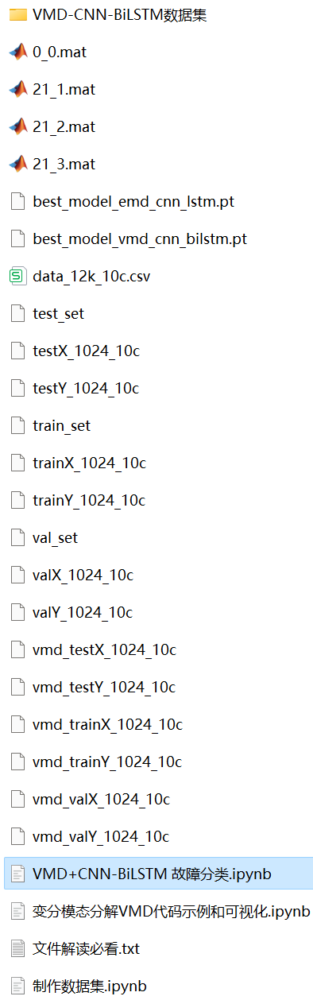
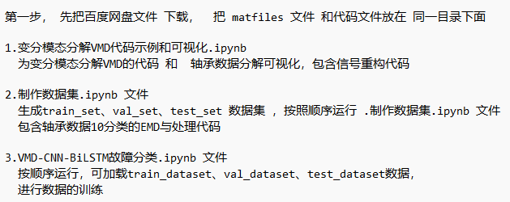

# Bearing Fault Classification Model with VMD-CNN-BiLSTM

The family pack includes the following content:
- Complete bearing fault dataset,
- VMD decomposed fault signal dataset, classification data and label set that have been generated and prepared, all of which can be run,
- VMD fault signal decomposition example.
- 50 epochs, with an accuracy nearing 97%, the classification effect of the VMD-CNN-BiLSTM network is significant. The CNN-BiLSTM model can fully extract the spatial and temporal features of bearing fault signals, has a fast convergence speed, and performs excellently.
- Code for VMD preprocessing of the data and the VMD-CNN-BiLSTM classification code.
Environment: Python 3.9

## Images

<!-- PAYMENT_BLOCK -->

## Get this dataset

- Payment link (Stripe): [Buy now](https://buy.stripe.com/3cs8yP7sY87d0vu9AB)
- Payment QR code: 

<!-- /PAYMENT_BLOCK -->
